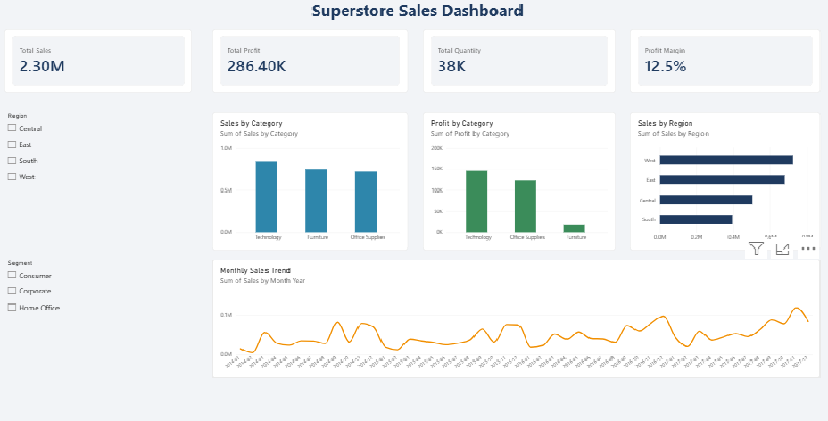

# Superstore Sales Dashboard

An interactive Power BI dashboard analysing 9,994 orders from the Superstore dataset (2014-2017).

## Dashboard

## Key Insights
- Total sales of $2.30M and profit of $286K, a profit margin of 12.5%.
- Technology is the strongest category in both sales ($836K) and profit ($145K).
- Furniture generates $742K in sales but only $18K in profit (2.5% margin), so pricing, discounts and costs need a closer look.
- West is the top region ($725K, 32% of sales); South is the weakest ($392K).
- Sales grew from $484K in 2014 to $733K in 2017, peaking in November and December.

## What I Did
- Cleaned the data in Power Query and fixed the date format (US locale)
- Built KPI cards, four charts and two slicers (Region, Segment)
- Wrote a DAX measure for Profit Margin
- Added a Month-Year column for the monthly trend chart

## Tools
Power BI, Power Query, DAX

## Dataset
Kaggle: Superstore Dataset (Final) by vivek468

## Files
- `Superstore_Dashboard.pbix`: open with Power BI Desktop
- `dashboard.png`: screenshot of the dashboard

## Note
I used an AI assistant for guidance while learning. I built the dashboard myself in Power BI.# superstore-sales-dashboard
